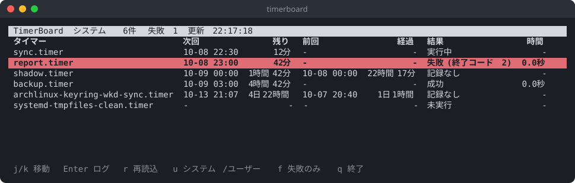

# TimerBoard

systemd タイマーの「いつ何が動いて、成功したか失敗したか」を一覧にする道具です。
cron の代わりに systemd タイマーを使っている人向けです。

**読むだけ**です。タイマーの開始・停止・有効化はしません。

## 何をするか

タイマー1つにつき1行で、次のものを並べます。

| 列 | 中身 |
| --- | --- |
| タイマー / サービス | タイマー名と、それが起動するサービス名 |
| スケジュール | `OnCalendar=*-*-* 03:00:00` `OnBootSec=15min` `OnUnitActiveSec=1d` など |
| 次回 / 残り | 次に動く時刻と、それまでの残り時間 |
| 前回 / 経過 | 前に動いた時刻と、それからの経過時間 |
| 結果 | 成功 / 失敗(終了コード2) / 実行中 / 未実行 / 記録なし |
| 時間 | 前回かかった時間 |
| 有効 | `UnitFileState`(有効・無効・静的・一時 など) |

- 失敗は赤で目立たせます。
- 「未実行」は一度も動いていないもの、「記録なし」は前回の時刻はあるが(再起動をまたいだなどで)結果がもう残っていないものです。
- 取れない値は `-` で出し、0 で埋めません。

## 画面



(112桁の端末で、見本のタイマーを3つ足して撮ったもの。広ければサービス・スケジュール・有効の列も出ます。`--list` は常に全部の列を出します。)

Enter を押すと、選んだサービスの直近のログ(`journalctl -u <サービス> -n 30`)を出します。

## 動作環境

- Linux(systemd)。Arch Linux で確認しています。
- Python 3.11 以上。依存はありません(標準ライブラリだけ)。

## 入れ方

pipx で入れる:

```sh
pipx install git+https://github.com/takosasi-dev/timer-board
```

clone して動かす:

```sh
git clone https://github.com/takosasi-dev/timer-board
cd timer-board
python -m timerboard
```

## 使い方

```sh
timerboard              # TUI(システムのタイマー)
timerboard --user       # TUI(ユーザーのタイマー)
timerboard --list       # 表をテキストで出す
timerboard --json       # JSON で出す
timerboard --failed     # 前回失敗したタイマーだけ。1件でもあれば終了コード 1
```

TUI のキー:

| キー | 動き |
| --- | --- |
| j / k / ↓ / ↑ | 移動 |
| Enter | 選んだサービスの直近のログ(j/k でスクロール、q・Esc・Enter で戻る) |
| r | 再読み込み |
| u | システム / ユーザーの切り替え |
| f | 失敗だけに絞る |
| q | 終了 |

1秒ごとに残り時間を進め、10秒ごとに一覧を取り直します。端末が狭いときは、
サービス → 有効 → スケジュール → 時間 → 前回 … の順に列を減らします(タイマーと結果は残します)。

### 監視に使う

`--failed` は失敗があると終了コード 1 を返すので、cron やスクリプトからそのまま使えます。

```sh
timerboard --failed || echo "失敗したタイマーがあります"
```

終了コード: `0` 失敗なし / `1` 失敗あり / `2` 一覧が取れない(systemctl が無い、ユーザーのマネージャーに繋がらない など)。

ユーザーのマネージャーに繋がらない環境(WSL の root など)で `--user` を付けると、
落ちずに「ユーザーのタイマーは取れない」と理由を出します。

### データの取り方

- `systemctl list-timers --all --output=json` が使えればそれを、使えない古い systemd では表の出力を解析します。
- 詳細は、全タイマーと全サービスをまとめた `systemctl show ... -p ...` を1回だけ呼んで取ります
  (タイマーの数だけプロセスを起こしません)。

## 安全面の注意

- 読むだけです。`systemctl` は `list-timers` と `show` しか呼ばず、ほかに `journalctl` でログを読むだけです。
- root でなくても動きます。ただしログ(`journalctl`)は、権限によっては見えない行があります。

## 既知の限界

- 一度きりのタイマー(`systemd-run --on-active=...` など)は、発火すると systemd がすぐ片付けるので一覧から消えます。
- 「前回」はこのブートで記録された結果です。再起動をまたぐと、`Persistent=` のタイマーは前回の時刻だけ残り、結果は「記録なし」になります。

## ライセンス

MIT

## 開発状況

v0.1.0。
